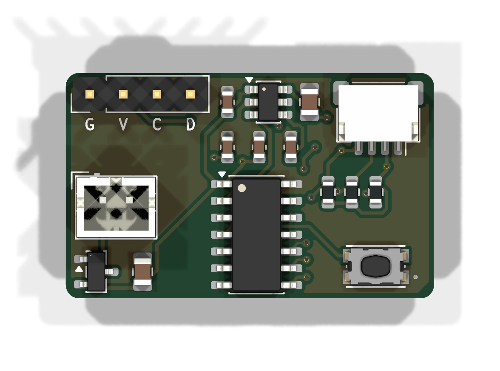
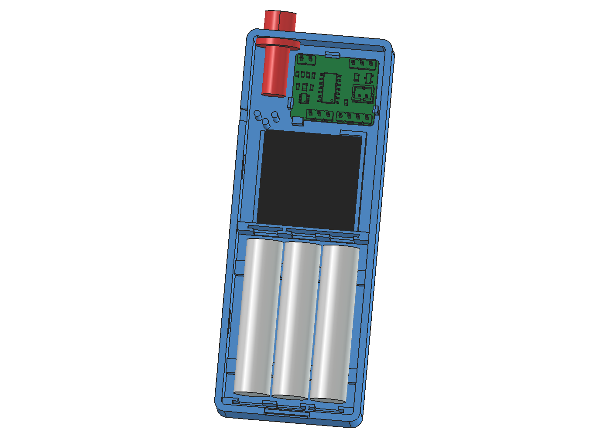
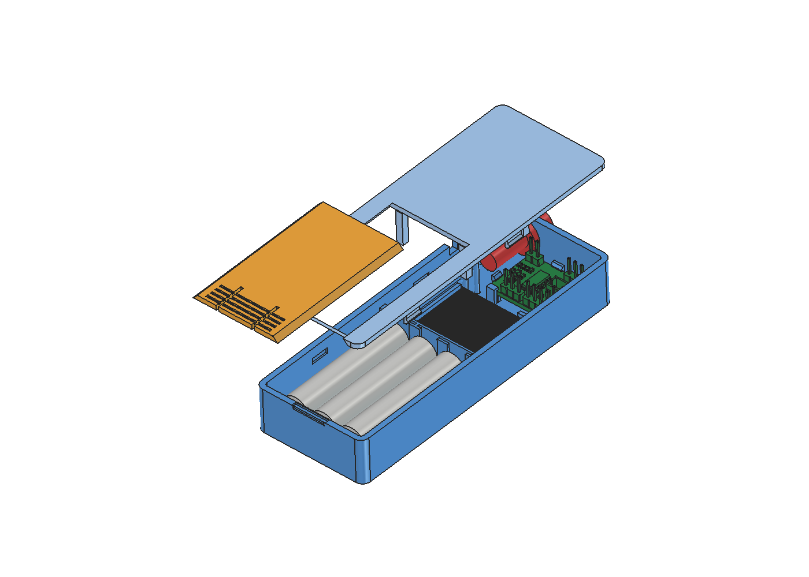
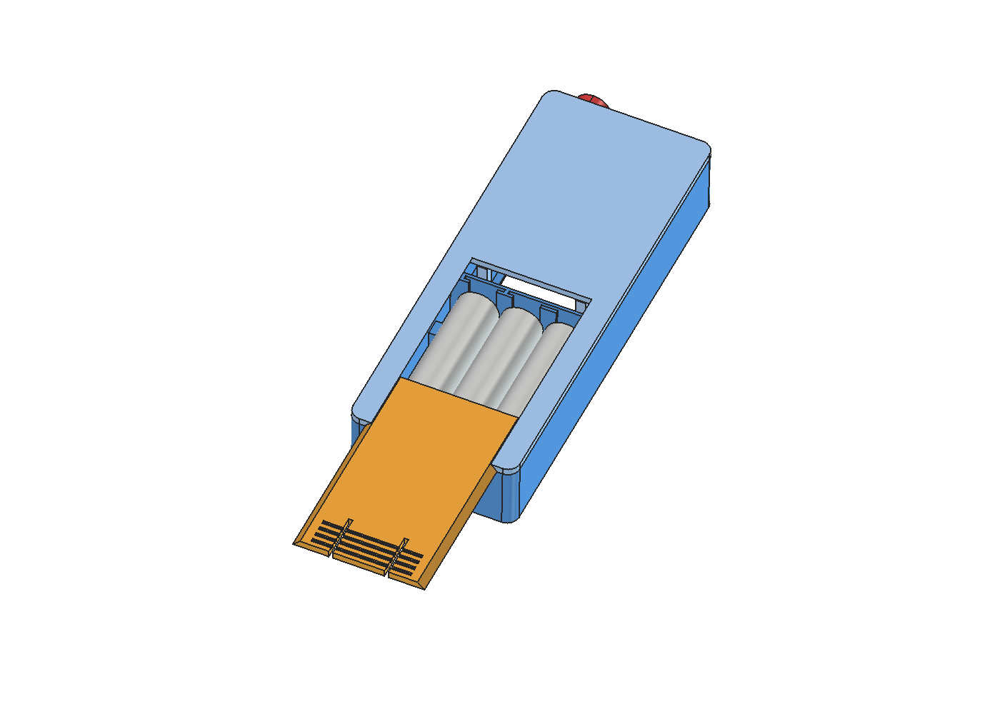
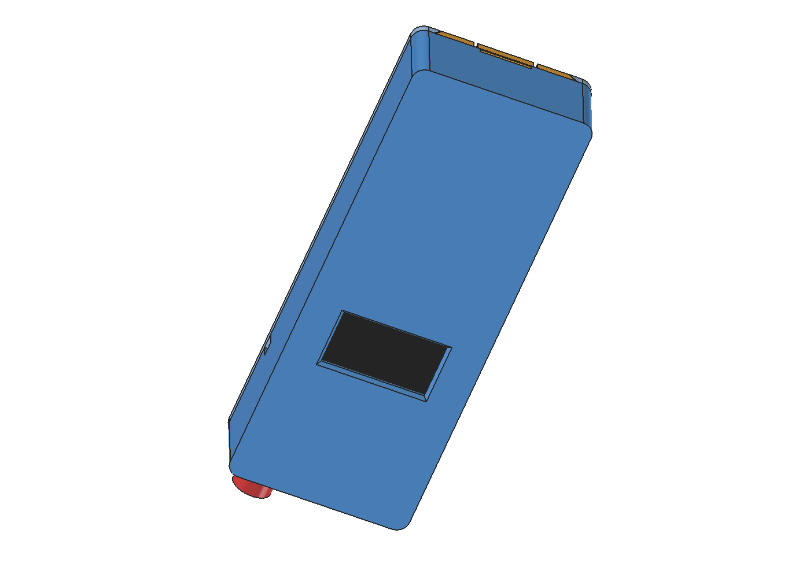
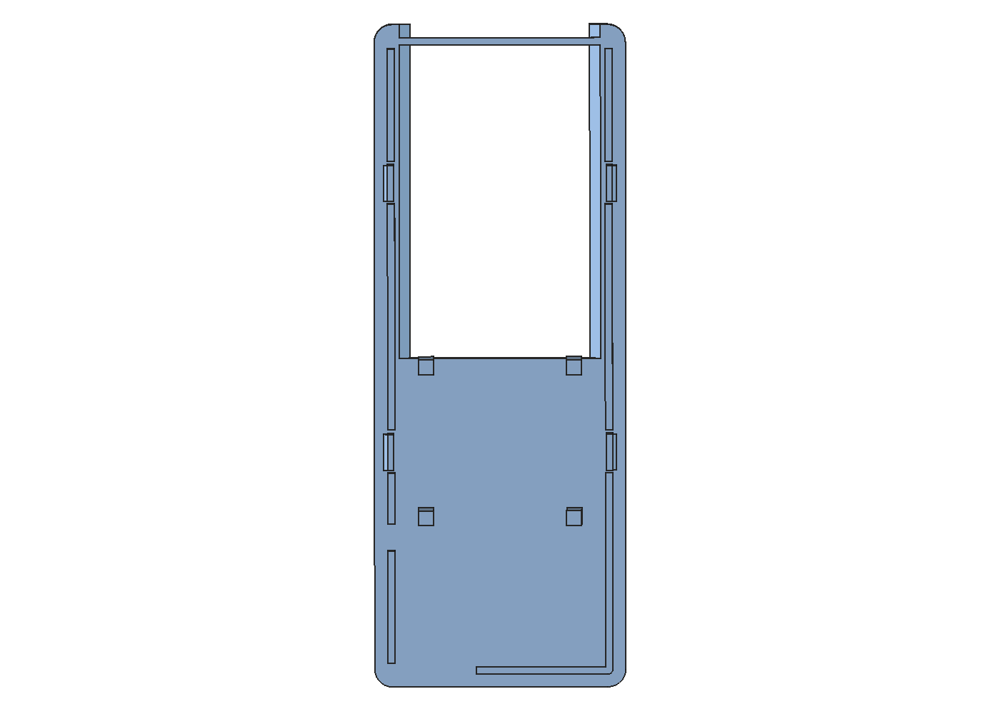

# Soil Moisture Sensor

Button-activated, battery-powered soil moisture meter with a 0.96" OLED display.

Press the button -> MCU wakes -> load switch powers the OLED and sensor -> moisture reading is shown for 15 s -> everything powers down (<1 uA standby).

## Hardware
| Ref | Function | Part |
|---|---|---|
| U1 | MCU | Microchip ATtiny1614-SSNR (SOIC-14) |
| J5 | Battery | 3xAAA holder with leads -> JST-PH 2-pin (direct, 3.0-4.8 V) |
| Q1 | Reverse-polarity protection | Diodes DMG3415U P-FET |
| U2 | Peripheral power switch | TI TPS22917DBVR load switch |
| J2 | Display | ELEGOO 0.96" SSD1306 I2C OLED (0x3C) - 2.54 mm pads, GND-VCC-SCL-SDA |
| J3 | Sensor | DIYmall capacitive soil sensor v1.2 (analog) - 2.54 mm pads, GND-VCC-AOUT |
| SW1 | Button | Twidec PBS-110 7 mm panel-mount momentary, leads soldered to 2 pads |
| J1 | Programming | UPDI through-hole pads on the board edge (UPDI-GND-VCC) |

See `BOM.csv` for the full parts list and `Moisture_Sensor.pdf` for the schematic.

## PCB (rev C)
- 24 x 19 mm, 2-layer, 1.6 mm, all SMD on top, GND pour both sides.
- Top edge: OLED (G V C D) and sensor (G V A) pads. Bottom edge: UPDI (U G V) and button pads.
- Solder the supplied Dupont/PH cables directly to the pads (or fit 2.54 mm headers).
- No mounting holes: hold the board with a ledge/snap clips. `Moisture_Sensor.step` is provided for enclosure design.

## Programming
UPDI via a 3.3 V USB-serial adapter with a 4.7k resistor TX->UPDI, RX->UPDI ("SerialUPDI"), or an Adafruit UPDI Friend.
Arduino IDE + megaTinyCore, board ATtiny1614, programmer SerialUPDI. Remove batteries when powering from the programmer.

## Pin map (ATtiny1614)
| Signal | Port | Pin |
|---|---|---|
| LOAD_EN | PA4 | 2 |
| AOUT (sensor, ADC) | PA5 | 3 |
| BTN (wake) | PA6 | 4 |
| SDA | PB1 | 8 |
| SCL | PB0 | 9 |
| UPDI | PA0 | 10 |

## Enclosure

| | |
|---|---|
|  |  |
|  |  |

Outer size **42 × 111 × 18.4 mm**. Generated by `tools/gen_enclosure.py`, which is fully parametric (run it with FreeCAD's `freecadcmd.exe`). The script also checks for interference against the real PCB STEP model and against dummy models of the OLED, the AAA cells and the button. `tools/render_enclosure.py` (run with `freecad.exe`) regenerates the images.

| Part | File | Print orientation |
|---|---|---|
| Body (tub) | `enclosure/body.stl` | display face down, as exported |
| Lid | `enclosure/lid.stl` | outer face down, as exported |
| Battery door | `enclosure/door.stl` | outer face down, as exported |

**Printing:** no supports are needed. The button hole is a teardrop, the display window has a 45° chamfer, the clip lips overhang by 0.5 mm or less, and the door rails are 45° dovetails. Use 0.2 mm layers, 3–4 perimeters, and **PETG** (recommended for the snap clips). PLA works, but the clips run at about 3 % strain.

**Features**
- **Display:** a window in the front face. The module drops into a pocket with corner ledges, and the lid has 4 posts that clamp the module's corners.
- **PCB:** held by 3 flexible snap clips plus 1 rigid hook, on 3 mm standoffs. To insert it, tilt the board and slide its J2/J3 edge (toward the display) under the rigid hook, then press the other edge down until the clips snap.
- **Button:** a 7 mm hole in the top end wall. The nut tightens from inside.
- **Sensor cable:** a U-notch in the side wall at the lid seam, so the cable is laid in rather than threaded. Weave the cable around the 3 posts for strain relief.
- **Batteries:** 3×AAA side by side behind a sliding dovetail door. To open it, lift the flex tab at the finger grooves and slide the door out toward the bottom end.
  - Contacts are generic AAA plates/springs in 0.8 mm slots: a single plate for 10 mm-wide contacts, a double slot for 21 mm-wide bridging contacts.
  - Top fence: single (+, cell 1, left) and double (cells 2/3).
  - Bottom fence: double (cells 1/2) and single (−, cell 3).
  - Run the + and − wires to the J5 JST-PH plug.
- **Lid:** snap-fit with 4 tabs; no screws. Open it only for programming (the UPDI pads are reachable with the lid off).

**Verify before printing** (all are parameters at the top of `gen_enclosure.py`):
- OLED glass and viewing-area offsets (`GLASS_*`, `VIEW_*`).
- Button body length (the space behind the wall is about 18 mm).
- Contact plate dimensions.
- Rebuild after any change.
## Notes
- Sensor: bypass its onboard 662K LDO (the NE555 is otherwise starved at 3.3 V). Its output then scales with supply, so read it ratiometrically (ADC reference = VDD). Calibrate dry/wet values in firmware.
- OLED runs from VSW through its own LDO (3.3-5 V); no mod needed.
- Firmware: 10 MHz is fine (>2.7 V); set I2C pins high-Z before switching off VSW; low-battery cutoff ~3.3 V.
- `tools/gen_sch.py` regenerates the schematic and `tools/gen_pcb.py --route` the PCB (KiCad's bundled Python; routing needs Freerouting + Java 25).
